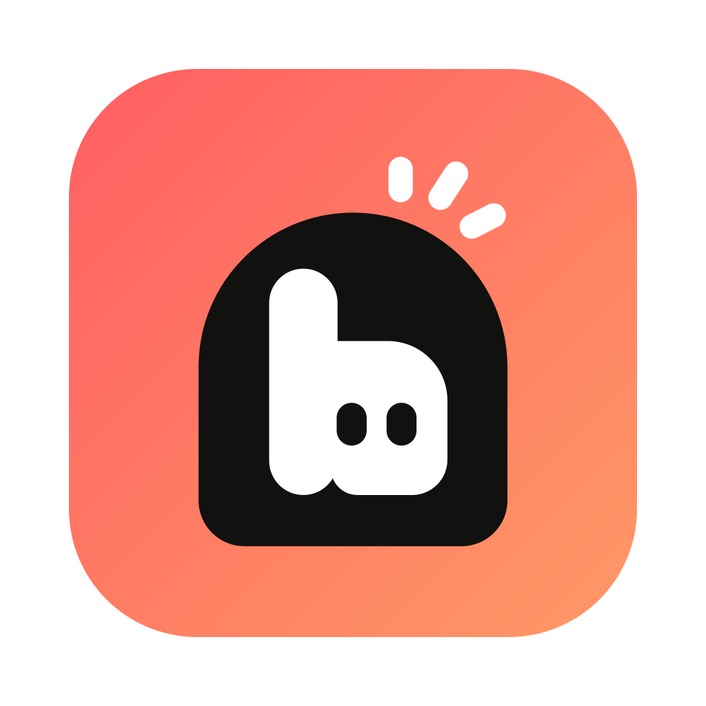
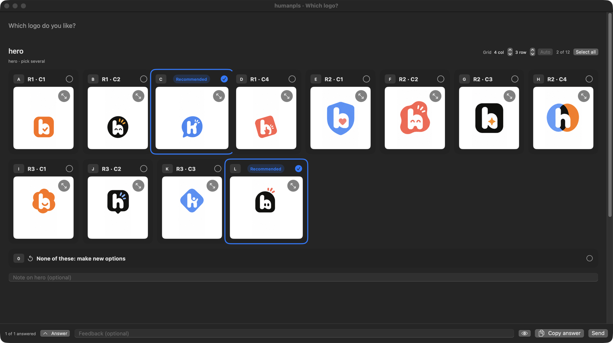
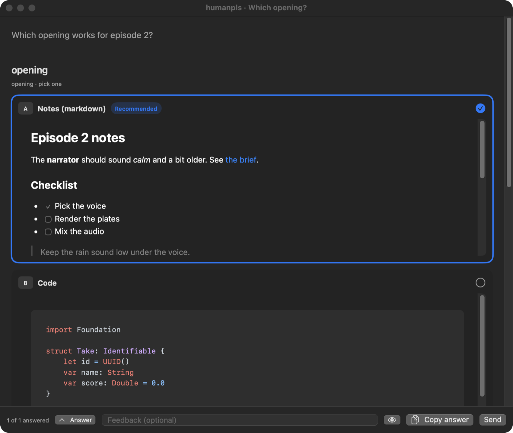

<p align="center">
  
</p>

<h1 align="center">humanpls</h1>

<p align="center">
  <em>Human, please.</em><br>
  A native macOS popup that lets your AI agent ask you to pick between options, or just show you files.
</p>

<p align="center">
  macOS 14+ &nbsp;·&nbsp; Swift, no dependencies &nbsp;·&nbsp; one app, one command &nbsp;·&nbsp; MIT
</p>

<p align="center">
  
</p>

## Why

Agents are good at making things and bad at asking which one you want.

- They give you **paths**, and you open every file yourself.
- They give you **one image with twelve logos**, and you cannot pick one of them.
- They ask in the chat, and you type "the third one, but bluer".

humanpls fixes this. The agent runs one command, a popup opens with the options, you click, and your answer goes straight back into the chat. No browser, no lost focus, no copying paths.

```
humanpls pick --id narrator --question "Which take fits?" a.wav::calm "*b.wav::older, raspy" c.wav
humanpls pick --id ep02 --section Name text:Aung text:Maung --section Plates --multi a.png b.png c.png
humanpls pick --id logo --slice auto logo-sheet.png     # one image with many logos: pick a cell
humanpls show gen/ clip.mp4 notes.md                    # just look at things
humanpls reopen                                         # open the last popup again
```

## What it looks like

<table>
  <tr>
    <td width="50%" valign="top">
      <br>
      <b>Compare.</b> Two images side by side with the same zoom and position, or flip between them with <code>F</code>.
    </td>
    <td width="50%" valign="top">
      <br>
      <b>Any content.</b> Markdown and code with colors, audio, video, images, PDF, text. Any other file gets a Quick Look card.
    </td>
  </tr>
</table>

The top screenshot is the **image sheet** feature: the agent made one picture with twelve logos, humanpls found the grid, cut it into twelve cards, and you pick like in any other question. The picked cells come back as separate files.

## What it does

- **pick**: a sidebar page with one card per option. Text, audio (waveform), image (zoom), video, markdown and code (with syntax colors), HTML, PDF, and any other file (Quick Look thumbnail, Open, Reveal). Pick one or several, "none of these", a note per question, a Recommended badge that starts picked, select all.
- **Image sheets**: `--slice auto` cuts one image (a logo grid, a contact sheet) into cells that you pick like separate options. The grid is found from the empty space between the marks. If it is wrong, use `--slice 4x3` (columns x rows) or the Grid steppers on the card. The picked cells are cut out at full resolution into `~/Library/Application Support/humanpls/crops/` and their paths go into the answer. The sheet itself is never copied or changed.
- **show**: a viewer with a file list. Images: pinch zoom, pen, rectangle, arrow, text, colors, undo; Info panel with the prompt and seed stored in PNG files; A/B compare (side by side with synced zoom, or flip with `F`). Video: J K L (backward, pause, forward, faster on repeat), frame step, `M` to mark a moment with a note. Audio: waveform, marks.
- **Send**: the answer is pasted into the terminal that ran the command and Enter is pressed. With tmux it goes to the exact pane, even if you switched apps. Otherwise it goes to the terminal app (needs the Accessibility permission). **Copy answer** (`⇧⌘C`) copies the answer text, shows "Copied", and the popup stays open so you can still change it or press Send. `--wait` prints the answer instead, for agents that can wait. Paths with spaces are put in quotes in the answer.
- **Menu bar icon** with the history. Click a popup to open it again with your picks.
- **The popup** opens on the screen where your mouse is, is visible on every desktop (also over a full-screen terminal), and remembers its size.
- **Keyboard**: `A`-`Z` pick, `0` none of these, `[` `]` change question, `Space` or `⌘Y` Quick Look, `⌘↩` send, `⇧⌘C` copy the answer, `Esc` cancel. The letter shortcuts are off while you type in a text field, where `⌘A` `⌘C` `⌘V` `⌘X` `⌘Z` work as usual (the app has a hidden Edit menu for this).

Files are read from the path the agent gave. Nothing is copied. The only new files are annotated images and cut-out cells: they are written to `~/Library/Application Support/humanpls/annotations/` and `.../crops/` and deleted after 14 days.

## Logo

A friendly dome-shaped body with a chunky white `h`, two little eyes and three coral sparks ("psst, human"). It was picked from AI logo sheets with humanpls itself (`pick --slice auto`) and rebuilt as clean vectors.

`scripts/make-logo.py` builds everything from one geometry: `design/logo/humanpls-mark.svg` (color), `humanpls-mark-on-dark.svg`, `humanpls-mark-mono.svg` (one color, no sparks), `humanpls-app-icon.svg/.png` (the black mark on a coral-to-orange sunset gradient; other backgrounds are in `ICON_OPTIONS` in the script, `python3 scripts/make-logo.py --options DIR` renders them all), `AppIcon.icns` (used by `build-app.sh`), and the menu bar icon, which is built into the binary (`Sources/humanpls/Assets.swift`) as a template image so macOS tints it for light and dark menu bars. It needs `rsvg-convert` (`brew install librsvg`).

## Install

```
./scripts/install.sh
```

Builds `humanpls.app` into `~/Applications` and links the `humanpls` command into `~/.local/bin`. Needs macOS 14+ and Xcode (Swift 6).

Development: `swift build`, `swift test`, `./scripts/e2e.sh`, `./scripts/build-app.sh debug`.

## Layout

```
Sources/HumanplsCore   job model, option parsing, answer text, history, marks, annotations, socket. No UI. Unit tested.
Sources/humanpls       the app and the CLI (one binary: no arguments = menu bar app)
Tests/                 unit tests for the core
scripts/               install, build-app, e2e, make-logo, gen-vendor
design/logo/           the logo: SVG and PNG of the mark, a dark version, the app icon (AppIcon.icns)
vendor/                marked and highlight.js, turned into Sources/humanpls/Vendor.swift by scripts/gen-vendor.py
docs/PROTOCOL.md       the CLI, the socket protocol, the JSON options format and the answer text
```

## Tests

- `swift test`: core logic (option parsing, answers, history, PNG text chunks, marks, annotation undo, image-sheet slicing, socket). 37 tests.
- `./scripts/e2e.sh`: CLI to socket to app to answer, with no window (`HUMANPLS_AUTOANSWER`), including slicing a sheet and exporting a crop. 17 checks. Run it on the built app with `BIN=build/humanpls.app/Contents/MacOS/humanpls ./scripts/e2e.sh`.
- `humanpls selftest`: draws annotations, exports a PNG and checks pixels, color profile and file locations; cuts a cell out of a sheet; checks the Edit menu shortcuts.

The visual parts (layout, clicks, zoom feel) are checked by hand.

## maggot

The `humanpls` maggot tool is a bridge: it finds the `humanpls` command and passes the arguments on. It lives in the maggot drafts folder, not in this repo.

## License

MIT, see `LICENSE`. The app includes marked (MIT) and highlight.js (BSD-3-Clause), see `THIRD_PARTY.md`.
