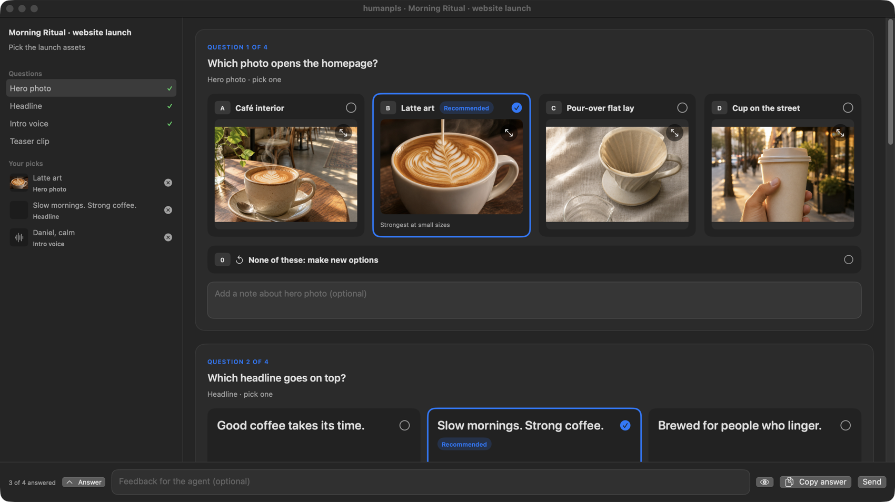
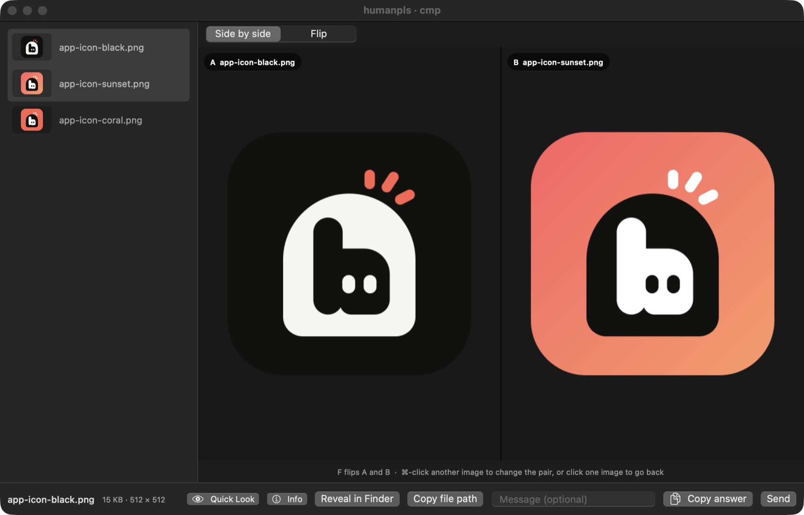

<p align="center">
  
</p>

<h1 align="center">humanpls</h1>

<p align="center">
  <em>Human, please.</em><br>
  A native macOS popup that lets your AI agent ask you to pick between options, or just show you files.
</p>

<p align="center">
  macOS 14+ &nbsp;·&nbsp; Swift, no dependencies &nbsp;·&nbsp; one app, one command &nbsp;·&nbsp; MIT
</p>

<p align="center">
  
</p>

## Why

Agents are good at making things and bad at asking which one you want.

- They give you **paths**, and you open every file yourself.
- They give you **one image with twelve logos**, and you cannot pick one of them.
- They ask in the chat, and you type "the third one, but bluer".

humanpls fixes this. The agent runs one command, a popup opens with the options, you click, and your answer goes straight back into the chat. No browser, no lost focus, no copying paths.

```
humanpls pick --id narrator --question "Which take fits?" a.wav::calm "*b.wav::older, raspy" c.wav
humanpls pick --id ep02 --section Name text:Aung text:Maung --section Plates --multi a.png b.png c.png
humanpls pick --id logo --slice auto logo-sheet.png     # one image with many logos: pick a cell
humanpls show gen/ clip.mp4 notes.md                    # just look at things
humanpls reopen                                         # open the last popup again
```

## What it looks like

The picture above is one popup with **four questions** for a website launch. The sidebar lists the questions (a check when answered) and keeps **your picks** with thumbnails. Every option is a card you can click: photos, headlines, audio with a waveform, video.

<table>
  <tr>
    <td width="50%" valign="top">
      <br>
      <b>Compare.</b> Two versions of an image side by side with the same zoom and position, or flip between them with <code>F</code>.
    </td>
    <td width="50%" valign="top">
      <br>
      <b>Any content.</b> Code and markdown with colors, audio, video, images, PDF, text. Any other file gets a Quick Look card.
    </td>
  </tr>
</table>

## What it does

- **pick**: one popup for one or several questions. A **sidebar** shows the title, the questions (with a check when answered) and **your picks** so far, with thumbnails and a remove button. Each option is a card: text, audio (waveform), image (zoom), video, markdown and code (with syntax colors), HTML, PDF, and any other file (Quick Look thumbnail, Open, Reveal). Pick one or several, a note per question, a Recommended badge that starts picked, select all. **None of these: make new options** is built into every question, so the agent must not add its own "none" or "try again" option (the command tells it when it does).
- **Required questions**: every question needs an answer. If you press Send or Copy while a question has no pick (for example the agent recommended nothing), the popup does not close: it jumps to that question and marks it in red. Pick an option or "None of these". The agent can pass `--optional` when no pick is a valid answer.
- **Attach files**: every note field, the feedback field and the message field in `show` take files. Click the paperclip, drop files on the field, or press `⌘V` with a copied file or a screenshot. Good for "use this kind of style". The paths come back in the answer as `attached: ...`.
- **Image sheets**: `--slice auto` cuts one image (a logo grid, a contact sheet) into cells that you pick like separate options. The grid is found from the empty space between the marks. If it is wrong, use `--slice 4x3` (columns x rows) or the Grid steppers on the card. Each cell is trimmed to its content, so a logo is not a small mark in a big white cell. The picked cells are cut out at full resolution into `~/Library/Application Support/humanpls/crops/` and their paths go into the answer. The sheet itself is never copied or changed.
- **show**: a viewer with a file list. Images: pinch zoom, pen, rectangle, arrow, text, colors, undo; Info panel with the prompt and seed stored in PNG files; A/B compare (side by side with synced zoom, or flip with `F`). Video: J K L (backward, pause, forward, faster on repeat), frame step, `M` to mark a moment with a note. Audio: waveform, marks.
- **One window**: when several agents ask at the same time, the popups do not pile up. They are tabs of one window, in the order they arrived. A new popup never takes the place of the one you are working on. When you Send, Copy or cancel, that tab closes and the next one shows; the window closes with its last tab. `⌃⇥` and `⇧⌘]` `⇧⌘[` move between tabs. Hover a tab to see the folder of the agent that asked.
- **Send**: the answer is pasted into the terminal that ran the command and Enter is pressed. With tmux it goes to the exact pane, even if you switched apps. Otherwise it goes to the terminal app (needs the Accessibility permission). **Copy answer** (`⇧⌘C`) copies the answer text and closes the popup, like Send but without pasting. `--wait` prints the answer instead, for agents that can wait. If the waiting command gives up first (timeout, killed shell), the popup stays open and a later Send pastes the answer into the chat, so it is never lost. Paths with spaces are put in quotes in the answer.
- **Menu bar icon** with the history. Click a popup to open it again with your picks.
- **The popup** opens on the screen where your mouse is, is visible on every desktop (also over a full-screen terminal), and remembers its size.
- **Keyboard**: `A`-`Z` pick, `0` none of these, `[` `]` change question, `Space` or `⌘Y` Quick Look, `⌘↩` send, `⇧⌘C` copy the answer, `⌃⇥` next popup, `Esc` cancel. The letter shortcuts are off while you type in a text field, where `⌘A` `⌘C` `⌘V` `⌘X` `⌘Z` work as usual (the app has a hidden Edit menu for this).

Files are read from the path the agent gave. Nothing is copied. If the agent writes a file again at the same path (renders the video again, deletes it and makes a new one), the popup loads the new file: when it opens, and also while it is open (it looks once a second and waits until the file stops changing). The only new files are annotated images and cut-out cells: they are written to `~/Library/Application Support/humanpls/annotations/` and `.../crops/` and deleted after 14 days.

## Logo

A friendly dome-shaped body with a chunky white `h`, two little eyes and three coral sparks ("psst, human"). It was picked from AI logo sheets with humanpls itself (`pick --slice auto`) and rebuilt as clean vectors.

`scripts/make-logo.py` builds everything from one geometry: `design/logo/humanpls-mark.svg` (color), `humanpls-mark-on-dark.svg`, `humanpls-mark-mono.svg` (one color, no sparks), `humanpls-app-icon.svg/.png` (the black mark on a coral-to-orange sunset gradient; other backgrounds are in `ICON_OPTIONS` in the script, `python3 scripts/make-logo.py --options DIR` renders them all), `AppIcon.icns` (used by `build-app.sh`), and the menu bar icon, which is built into the binary (`Sources/humanpls/Assets.swift`) as a template image so macOS tints it for light and dark menu bars. It needs `rsvg-convert` (`brew install librsvg`).

## Install

**Download** (easiest): get `humanpls-<version>.dmg` from the [Releases](https://github.com/nxnom/humanpls/releases) page, open it, and drag **humanpls** to **Applications**. Open it once. A menu bar icon appears. Click it and choose **Install 'humanpls' command…**: this puts the `humanpls` command on your PATH (it may ask for your password once). The first time macOS may say the app is from an unidentified developer: right click the app, choose **Open**, then **Open** again. This is needed once, because the app is not notarized yet.

**Homebrew** (installs the app and the command in one step):

```
brew tap nxnom/humanpls https://github.com/nxnom/humanpls
brew install --cask humanpls
```

**From source** (needs Xcode, Swift 6, macOS 14+):

```
git clone https://github.com/nxnom/humanpls && cd humanpls
./scripts/install.sh      # builds the app into ~/Applications and links the command into ~/.local/bin
```

Then try: `humanpls pick --id test "text:Yes" "text:No"`. The agent's terminal needs the `humanpls` command on its PATH. In tmux the answer goes to the exact pane; otherwise it goes to the terminal app and macOS asks for the Accessibility permission once.

For developers: `swift build`, `swift test`, `./scripts/e2e.sh`, `./scripts/build-app.sh debug`. To make a release: `scripts/release.sh` (builds the universal app, the DMG and the Homebrew cask; it can sign with a Developer ID, see the script).

## Layout

```
Sources/HumanplsCore   job model, option parsing, answer text, history, marks, annotations, socket. No UI. Unit tested.
Sources/humanpls       the app and the CLI (one binary: no arguments = menu bar app)
Tests/                 unit tests for the core
scripts/               install, build-app, e2e, make-logo, gen-vendor
design/logo/           the logo: SVG and PNG of the mark, a dark version, the app icon (AppIcon.icns)
vendor/                marked and highlight.js, turned into Sources/humanpls/Vendor.swift by scripts/gen-vendor.py
docs/PROTOCOL.md       the CLI, the socket protocol, the JSON options format and the answer text
```

## Tests

- `swift test`: core logic (option parsing, answers, history, PNG text chunks, marks, annotation undo, image-sheet slicing, socket). 43 tests.
- `./scripts/e2e.sh`: CLI to socket to app to answer, with no window (`HUMANPLS_AUTOANSWER`), including slicing a sheet and exporting a crop. 17 checks. Run it on the built app with `BIN=build/humanpls.app/Contents/MacOS/humanpls ./scripts/e2e.sh`.
- `humanpls selftest`: draws annotations, exports a PNG and checks pixels, color profile and file locations; cuts a cell out of a sheet; checks the Edit menu shortcuts.

The visual parts (layout, clicks, zoom feel) are checked by hand.

## maggot

The `humanpls` maggot tool is a bridge: it finds the `humanpls` command and passes the arguments on. It lives in the maggot drafts folder, not in this repo.

## License

MIT, see `LICENSE`. The app includes marked (MIT) and highlight.js (BSD-3-Clause), see `THIRD_PARTY.md`.
